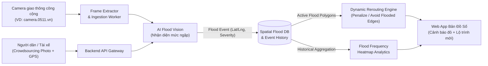

# Flood-Safe Routing — Bản Đồ Cảnh Báo Ngập & Điều Hướng Động (Dynamic Rerouting)

> **Hệ thống bản đồ số thông minh phát hiện điểm ngập nước cục bộ theo thời gian thực từ camera giao thông & ảnh cộng đồng, tự động tính toán lại lộ trình an toàn cho xe máy và giao vận chặng cuối.**

---

## 1. Bài toán (Problem Statement)

Các ứng dụng bản đồ và điều hướng hiện nay chủ yếu tối ưu lộ trình dựa trên **mật độ giao thông (kẹt xe)**, nhưng hoàn toàn **"mù" trước các điểm ngập nước cục bộ hoặc triều cường bất ngờ** tại các đô thị lớn như TP.HCM và Hà Nội.

**Hệ quả thực tế:**
- Hàng ngàn phương tiện (đặc biệt là xe máy) đi nhầm vào vùng ngập sâu dẫn đến chết máy, hư hỏng động cơ và thiệt hại tài sản.
- Các tuyến đường ngách, hẻm nhỏ bị tê liệt dây chuyền khi dòng xe quay đầu hoặc chết máy giữa dòng nước.
- Tài xế công nghệ và đội ngũ giao hàng chặng cuối bị gián đoạn thu nhập và chậm trễ đơn hàng nghiêm trọng trong mùa mưa bão.

---

## 2. Giải pháp (Bản Demo 24h)

Xây dựng một **Web App tích hợp bản đồ số thời gian thực** với quy trình khép kín:

1. **Thu nhận hình ảnh đa nguồn (Multi-source Ingestion):**
   - Kết nối trực tiếp với hệ thống **camera giao thông công cộng** (ví dụ: `camera.0511.vn`).
   - Tiếp nhận ảnh/báo cáo trực tiếp từ người dân và tài xế ngoài thực địa (**Crowdsourcing**).
2. **Nhận diện mức độ ngập bằng AI (Real-time AI Flood Vision):**
   - Tự động bóc tách frame ảnh theo thời gian thực từ luồng camera hoặc ảnh upload.
   - Phân tích bề mặt đường, mực nước so với bánh xe/vỉa hè để phân loại mức ngập (`An toàn` / `Ngập nhẹ` / `Ngập sâu - Nguy hiểm`).
3. **Cảnh báo trực quan trên bản đồ số:**
   - Tự động đánh dấu vùng đỏ và cập nhật trạng thái ngập tức thời lên các nút/đoạn đường tương ứng.
4. **Điều hướng động an toàn (Dynamic Rerouting):**
   - Ngay khi phát hiện điểm ngập mới trên lộ trình đang di chuyển, hệ thống lập tức tính toán lại tuyến đường thay thế an toàn hơn, né đoạn ngập sâu cho người đi xe máy.

---

## 3. Đối tượng mục tiêu (Target Users)

- **Người đi xe máy hằng ngày** tại các đô thị thường xuyên xảy ra ngập cục bộ và triều cường.
- **Tài xế công nghệ** (Grab, Be, Gojek...) cần tuyến đường thông suốt, hạn chế rủi ro chết máy.
- **Đội ngũ vận chuyển logistics chặng cuối (last-mile delivery)** hoạt động dày đặc trong các tuyến đường ngách.

---

## 4. Tiềm năng đóng góp & Tác động (Impact)

- **Cấp địa phương (Local Impact):**
  - Trực tiếp giảm thiệt hại tài sản (sửa xe, ngập nước) cho người dân và tài xế.
  - Giảm áp lực ùn tắc dây chuyền tại các tuyến đường ngách trong cao điểm mưa bão, triều cường.
- **Cấp quốc gia / Đô thị thông minh (National & Urban Planning Impact):**
  - Tự động tích lũy dữ liệu lịch sử để xây dựng **Heatmap (bản đồ nhiệt) tần suất ngập lũ** theo khu vực và khung giờ.
  - Cung cấp bộ dữ liệu thực nghiệm giá trị cho cơ quan quản lý đô thị phục vụ công tác quy hoạch, nâng cấp và cải tạo hạ tầng thoát nước.

---

## 5. Kiến trúc hệ thống đề xuất (System Architecture)



Xem chi tiết đặc tả kỹ thuật tại [docs/architecture.md](docs/architecture.md).

---

## 6. Cấu trúc thư mục Starter (Repository Structure)

```text
flood-safe-routing/
├── frontend/          # Web App bản đồ số (Map UI, cảnh báo đỏ, rerouting, heatmap, upload crowdsourcing)
├── backend/           # API Gateway, Dynamic Rerouting service, quản lý báo cáo & camera polling
├── ai-vision/         # Pipeline bóc tách frame camera & mô hình AI nhận diện mức độ ngập
├── data/              # Schema mẫu cho tọa độ camera, sự kiện ngập (GeoJSON) và dữ liệu heatmap
├── docs/              # Tài liệu kiến trúc hệ thống, luồng dữ liệu và API contracts
├── .env.example       # Biến môi trường mẫu
├── .gitignore
├── LICENSE
└── README.md
```

---

## 7. Lộ trình triển khai (24h Demo Roadmap)

- [x] **Phase 0 — Khởi tạo dự án:** Xác định bài toán, kiến trúc tổng quan, schema dữ liệu và khởi tạo repository.
- [ ] **Phase 1 — Ingestion & AI Vision:** Xây dựng module bóc tách frame từ camera công cộng / ảnh crowdsourcing và phân loại mức ngập (`0`–`3`).
- [ ] **Phase 2 — Spatial State & Dynamic Rerouting:** Lưu trữ trạng thái điểm ngập theo thời gian thực và gán trọng số né vùng ngập vào thuật toán tìm đường.
- [ ] **Phase 3 — Web App Map & Heatmap:** Hiển thị bản đồ số, điểm đánh dấu đỏ, luồng điều hướng lại (rerouting) và lớp bản đồ nhiệt tần suất ngập.
- [ ] **Phase 4 — Tích hợp & Demo End-to-End:** Kiểm thử kịch bản xuất hiện điểm ngập đột ngột và hệ thống tự động đổi tuyến đường trên giao diện Web App.
