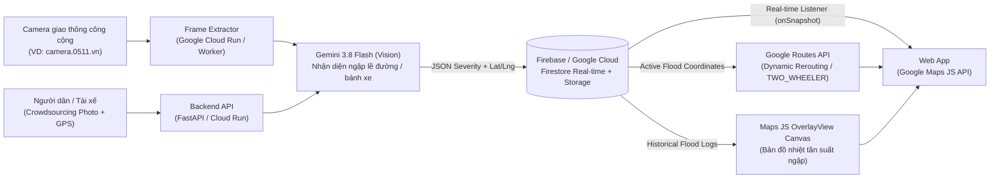

# Flood-Safe Routing — Bản Đồ Cảnh Báo Ngập & Điều Hướng Động (Dynamic Rerouting)

> **Hệ thống bản đồ số thông minh ứng dụng Gemini 3.8 Flash (Vision), Google Maps Platform và Firebase / Google Cloud để phát hiện điểm ngập nước theo thời gian thực từ camera giao thông & ảnh cộng đồng, tự động bẻ hướng lộ trình an toàn cho xe máy và giao vận chặng cuối.**

---

## 0. Dành Cho Thành Viên Nhóm (Contributor Quick Start)

Mọi thành viên khi `git clone` hoặc `git pull` repo về hãy thực hiện 3 bước sau để bắt đầu code ngay (hỗ trợ sẵn chế độ **`USE_MOCK_FALLBACK=true`** khi chưa có API key):

```bash
# 1. Tạo file biến môi trường từ mẫu
cp .env.example .env

# 2. Kiểm tra môi trường máy cá nhân (Python, Node, dữ liệu mẫu & trạng thái API keys)
python scripts/check_env.py

# 3. Chạy bộ kiểm thử tái lập & xác minh hợp đồng dữ liệu
python -m unittest discover -s tests -v
```

### Danh Mục Tài Liệu Dành Cho Contributor (Đọc Trước Khi Code)
| Tài liệu | Nội dung chính | Ai cần đọc? |
| :--- | :--- | :--- |
| [AGENTS.md](AGENTS.md) | Quy chuẩn kỹ thuật bắt buộc (English-only) cho mọi AI Coding Agent | **AI Coding Agents & Tech Lead** |
| [CONTRIBUTING.md](CONTRIBUTING.md) | Quy trình làm việc nhóm 3–4 người, phân vùng thư mục không conflict, quy tắc Git & Mock Fallback | **Tất cả thành viên** |
| [docs/implementation-plan.md](docs/implementation-plan.md) | Kế hoạch chia 5 Phase theo giờ (Giờ 0 -> Giờ 24), ma trận kỹ năng và phân công 4 vai trò | **Tất cả thành viên** |
| [docs/api-and-data-contract.md](docs/api-and-data-contract.md) | Hợp đồng REST API, Firestore Collections Schema và JSON Output của Gemini 3.8 Flash | **Frontend, Backend, AI** |
| [docs/resource-and-research-guide.md](docs/resource-and-research-guide.md) | Hướng dẫn tạo Gemini/Maps/Firebase keys & Giải thuật 2 lớp Dynamic Rerouting trên Routes API | **Backend, AI, Team Lead** |
| [docs/references/](docs/references/) | Tài liệu chuyên sâu (English-only) về `google-genai`, `Routes API v2`, `@vis.gl/react-google-maps`, `Firebase v10` & camera VN | **AI Coding Agents & Dev** |
| [docs/architecture.md](docs/architecture.md) | Tổng quan kiến trúc kỹ thuật thời gian thực, quy ước mức ngập `0`–`3` và Heatmap | **Tất cả thành viên** |
| [docs/idea-evaluation.md](docs/idea-evaluation.md) | Đánh giá SWOT và bộ câu trả lời phản biện Ban Giám Khảo (Q&A) | **Pitch Lead & Tất cả** |
| [docs/verification-and-demo-playbook.md](docs/verification-and-demo-playbook.md) | Checklist Verify từng module và kịch bản Demo sân khấu 3 phút | **QA & Pitch Lead** |

---

## 1. Bài toán (Problem Statement)

Các ứng dụng bản đồ hiện nay chỉ điều hướng dựa trên **mật độ kẹt xe**, hoàn toàn **"mù" trước các điểm ngập nước cục bộ hoặc triều cường bất ngờ** tại các đô thị lớn như TP.HCM và Hà Nội.

**Hệ quả thực tế:**
- Hàng ngàn phương tiện (đặc biệt là xe máy) bị chết máy, hư hỏng động cơ và gây thiệt hại tài sản cho người dân.
- Giao thông tại các tuyến đường ngách, hẻm nhỏ bị tê liệt dây chuyền khi phương tiện ngập nước hoặc phải quay đầu đột ngột.
- Tài xế công nghệ và đội ngũ giao hàng chặng cuối bị gián đoạn thu nhập và chậm trễ đơn hàng nghiêm trọng trong mùa mưa bão.

---

## 2. Giải pháp (Bản Demo 24h)

Xây dựng một **Web App tích hợp bản đồ số thời gian thực** với quy trình tự động khép kín:

1. **Thu nhận hình ảnh đa nguồn (Multi-source Ingestion):**
   - Kết nối trực tiếp với hệ thống **camera giao thông công cộng** (ví dụ: `camera.0511.vn`).
   - Tiếp nhận ảnh/báo cáo trực tiếp từ người dân và tài xế ngoài thực địa (**Crowdsourcing**).
2. **Nhận diện mức ngập tự động bằng AI Vision:**
   - Tự động bóc tách frame ảnh thời gian thực, sử dụng **Gemini 3.8 Flash (Vision)** để nhận diện mức độ ngập (ngập lề đường, ngập bánh xe...) mà không cần sức người.
3. **Cảnh báo đỏ & đồng bộ thời gian thực:**
   - Lưu tọa độ ngập lên **Firebase / Google Cloud**, đánh dấu đỏ trên bản đồ và đồng bộ cảnh báo ngay lập tức tới tất cả tài xế trong khu vực.
4. **Điều hướng động an toàn (Dynamic Rerouting):**
   - Tích hợp **Google Maps Platform (Maps JS & Routes API)** để lập tức tính toán lại lộ trình mới an toàn hơn, né các tọa độ vừa bị AI đánh dấu ngập.

---

## 3. Công nghệ Google ứng dụng (Google Tech Stack)

- **Gemini 3.8 Flash (Vision / Multimodal):** Xử lý hình ảnh trích xuất từ camera giao thông và ảnh crowdsourcing để tự động nhận diện mức độ ngập nước mà không cần sức người (phân loại ngập lề đường, ngập nửa bánh xe, ngập sâu).
- **Google Maps Platform (`Maps JavaScript API` & `Routes API`):** Hiển thị bản đồ số đô thị, trực quan hóa các điểm cảnh báo đỏ, lớp **Heatmap** tần suất ngập và tự động bẻ hướng di chuyển (**Dynamic Rerouting**, ưu tiên chế độ `TWO_WHEELER` cho xe máy) để né các tọa độ vừa bị AI đánh dấu ngập.
- **Firebase / Google Cloud:** Lưu trữ tọa độ ngập (`Cloud Firestore` / `Realtime Database`), lưu ảnh trích xuất (`Cloud Storage`), vận hành worker/API (`Cloud Run` / `Cloud Functions`) và đồng bộ cảnh báo theo thời gian thực (**Real-time**) đến tất cả tài xế trong khu vực.

---

## 4. Đối tượng mục tiêu (Target Users)

- **Người đi xe máy hằng ngày** tại các đô thị thường xuyên xảy ra ngập cục bộ và triều cường.
- **Tài xế công nghệ** (`Grab`, `Be`, `Gojek`...) cần tuyến đường thông suốt, hạn chế rủi ro chết máy.
- **Đội ngũ vận chuyển logistics chặng cuối (`last-mile delivery`)** hoạt động dày đặc trong các tuyến đường ngách.

---

## 5. Tiềm năng đóng góp & Tác động (Impact)

- **Cấp địa phương (Local Impact):**
  - Trực tiếp giảm thiệt hại tài sản cho người dân và tài xế.
  - Giải tỏa ách tắc luồng giao thông ngách trong mùa mưa bão, triều cường.
- **Cấp quốc gia / Đô thị thông minh (National & Urban Planning Impact):**
  - Tự động tích lũy dữ liệu lịch sử để xây dựng **Heatmap (bản đồ nhiệt) về tần suất ngập lũ**.
  - Cung cấp nguồn data thực tế vô giá cho cơ quan quản lý đô thị để quy hoạch, nâng cấp và cải tạo hạ tầng thoát nước.

---

## 6. Kiến trúc hệ thống (System Architecture)



---

## 7. Cấu trúc thư mục (Repository Structure)

```text
flood-safe-routing/
├── frontend/          # React + Vite + TS (Google Maps JS API, Firebase real-time alerts, Routes UI, Heatmap)
├── backend/           # Python FastAPI (Routes API flood-avoidance orchestration, Firestore service, REST API)
├── ai-vision/         # Python + google-genai (Pipeline bóc tách frame & gọi Gemini 3.8 Flash chấm mức độ ngập)
├── data/              # Dữ liệu mẫu cho tọa độ camera, sự kiện ngập (GeoJSON) và lịch sử heatmap
├── docs/              # Tài liệu kế hoạch, hợp đồng API/Firestore, SWOT, Verify & deep references
│   └── references/    # Tài liệu chuyên sâu (English-only) & code tái lập cho AI Coding Agents
├── scripts/           # Script kiểm tra môi trường & công cụ tái lập (check_env, repro_*)
├── tests/             # Bộ unit test & contract test tái lập (không cần API key trả phí)
├── AGENTS.md          # Quy chuẩn & chỉ dẫn bắt buộc dành cho AI Coding Agents
├── CONTRIBUTING.md    # Hướng dẫn làm việc nhóm & quy tắc nhánh Git
├── .env.example       # Biến môi trường mẫu (hỗ trợ sẵn USE_MOCK_FALLBACK=true)
├── .gitignore
├── LICENSE
└── README.md
```
