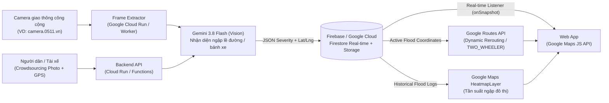

# Flood-Safe Routing — Bản Đồ Cảnh Báo Ngập & Điều Hướng Động (Dynamic Rerouting)

> **Hệ thống bản đồ số thông minh ứng dụng Gemini 3.8 Flash (Vision), Google Maps Platform và Firebase / Google Cloud để phát hiện điểm ngập nước theo thời gian thực từ camera giao thông & ảnh cộng đồng, tự động bẻ hướng lộ trình an toàn cho xe máy và giao vận chặng cuối.**

---

## 1. Bài toán (Problem Statement)

Các ứng dụng bản đồ hiện nay chỉ điều hướng dựa trên **mật độ kẹt xe**, hoàn toàn **"mù" trước các điểm ngập nước cục bộ hoặc triều cường bất ngờ** tại các đô thị lớn như TP.HCM và Hà Nội.

**Hệ quả thực tế:**
- Hàng ngàn phương tiện (đặc biệt là xe máy) bị chết máy, hư hỏng động cơ và gây thiệt hại tài sản cho người dân.
- Giao thông tại các tuyến đường ngách, hẻm nhỏ bị tê liệt dây chuyền khi phương tiện ngập nước hoặc phải quay đầu đột ngột.
- Tài xế công nghệ và đội ngũ giao hàng chặng cuối bị gián đoạn thu nhập và chậm trễ đơn hàng nghiêm trọng trong mùa mưa bão.

---

## 2. Giải pháp (Bản Demo 24h)

Xây dựng một **Web App tích hợp bản đồ số thời gian thực** với quy trình tự động khép kín:

1. **Thu nhận hình ảnh đa nguồn (Multi-source Ingestion):**
   - Kết nối trực tiếp với hệ thống **camera giao thông công cộng** (ví dụ: `camera.0511.vn`).
   - Tiếp nhận ảnh/báo cáo trực tiếp từ người dân và tài xế ngoài thực địa (**Crowdsourcing**).
2. **Nhận diện mức ngập tự động bằng AI Vision:**
   - Tự động bóc tách frame ảnh thời gian thực, sử dụng **Gemini 3.8 Flash (Vision)** để nhận diện mức độ ngập (ngập lề đường, ngập bánh xe...) mà không cần sức người.
3. **Cảnh báo đỏ & đồng bộ thời gian thực:**
   - Lưu tọa độ ngập lên **Firebase / Google Cloud**, đánh dấu đỏ trên bản đồ và đồng bộ cảnh báo ngay lập tức tới tất cả tài xế trong khu vực.
4. **Điều hướng động an toàn (Dynamic Rerouting):**
   - Tích hợp **Google Maps Platform (Maps JS & Routes API)** để lập tức tính toán lại lộ trình mới an toàn hơn, né các tọa độ vừa bị AI đánh dấu ngập.

---

## 3. Công nghệ Google ứng dụng (Google Tech Stack)

- **Gemini 3.8 Flash (Vision / Multimodal):** Xử lý hình ảnh trích xuất từ camera giao thông và ảnh crowdsourcing để tự động nhận diện mức độ ngập nước mà không cần sức người (phân loại ngập lề đường, ngập nửa bánh xe, ngập sâu).
- **Google Maps Platform (`Maps JavaScript API` & `Routes API`):** Hiển thị bản đồ số đô thị, trực quan hóa các điểm cảnh báo đỏ, lớp **Heatmap** tần suất ngập và tự động bẻ hướng di chuyển (**Dynamic Rerouting**, ưu tiên chế độ `TWO_WHEELER` cho xe máy) để né các tọa độ vừa bị AI đánh dấu ngập.
- **Firebase / Google Cloud:** Lưu trữ tọa độ ngập (`Cloud Firestore` / `Realtime Database`), lưu ảnh trích xuất (`Cloud Storage`), vận hành worker/API (`Cloud Run` / `Cloud Functions`) và đồng bộ cảnh báo theo thời gian thực (**Real-time**) đến tất cả tài xế trong khu vực.

---

## 4. Đối tượng mục tiêu (Target Users)

- **Người đi xe máy hằng ngày** tại các đô thị thường xuyên xảy ra ngập cục bộ và triều cường.
- **Tài xế công nghệ** (`Grab`, `Be`, `Gojek`...) cần tuyến đường thông suốt, hạn chế rủi ro chết máy.
- **Đội ngũ vận chuyển logistics chặng cuối (`last-mile delivery`)** hoạt động dày đặc trong các tuyến đường ngách.

---

## 5. Tiềm năng đóng góp & Tác động (Impact)

- **Cấp địa phương (Local Impact):**
  - Trực tiếp giảm thiệt hại tài sản cho người dân và tài xế.
  - Giải tỏa ách tắc luồng giao thông ngách trong mùa mưa bão, triều cường.
- **Cấp quốc gia / Đô thị thông minh (National & Urban Planning Impact):**
  - Tự động tích lũy dữ liệu lịch sử để xây dựng **Heatmap (bản đồ nhiệt) về tần suất ngập lũ**.
  - Cung cấp nguồn data thực tế vô giá cho cơ quan quản lý đô thị để quy hoạch, nâng cấp và cải tạo hạ tầng thoát nước.

---

## 6. Kiến trúc hệ thống (System Architecture)



Xem chi tiết đặc tả kỹ thuật tại [docs/architecture.md](docs/architecture.md).

---

## 7. Cấu trúc thư mục Starter (Repository Structure)

```text
flood-safe-routing/
├── frontend/          # Web App (Google Maps JS API, Firebase real-time alerts, Routes UI, Heatmap)
├── backend/           # Cloud Run / API Gateway, Routes API flood-avoidance orchestration, camera poller
├── ai-vision/         # Pipeline bóc tách frame & gọi Gemini 3.8 Flash (Vision) chấm mức độ ngập
├── data/              # Schema mẫu cho tọa độ camera, sự kiện ngập (GeoJSON) và dữ liệu heatmap
├── docs/              # Tài liệu kiến trúc hệ thống, luồng dữ liệu và kỹ thuật rerouting
├── .env.example       # Biến môi trường mẫu (Google Maps, Gemini API, Firebase)
├── .gitignore
├── LICENSE
└── README.md
```

---

## 8. Lộ trình triển khai (24h Demo Roadmap)

- [x] **Phase 0 — Khởi tạo dự án:** Xác định bài toán, chốt Google Tech Stack (Gemini 3.8 Flash, Google Maps Platform, Firebase / Google Cloud), schema dữ liệu và khởi tạo repository.
- [ ] **Phase 1 — Ingestion & Gemini 3.8 Flash Vision:** Bóc tách frame từ camera công cộng / ảnh crowdsourcing và gọi Gemini Multimodal trả JSON phân loại mức ngập (`0`–`3`).
- [ ] **Phase 2 — Firebase Real-time Sync:** Lưu tọa độ ngập và lịch sử lên Firestore, đồng bộ cảnh báo đỏ tức thời đến tất cả client trong khu vực.
- [ ] **Phase 3 — Google Maps JS & Routes API Rerouting:** Hiển thị bản đồ, vùng cảnh báo đỏ, lớp Heatmap và xử lý bẻ hướng tự động (`TWO_WHEELER`) né tọa độ ngập.
- [ ] **Phase 4 — Tích hợp & Demo End-to-End:** Kiểm thử kịch bản phát hiện điểm ngập mới từ camera/crowdsourcing và tự động chuyển hướng lộ trình tài xế theo thời gian thực.
