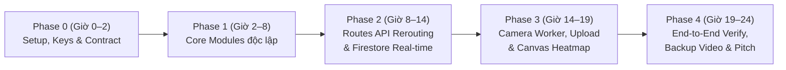

# Kế Hoạch Thực Thi Chi Tiết 24h (Implementation Plan & Phase Breakdown)

Tài liệu này quy định lộ trình triển khai từng bước từ khâu chuẩn bị tài nguyên, phân công kỹ năng đến chia Phase theo giờ cho đội ngũ 3–4 thành viên.

---

## 1. Ma Trận Kỹ Năng & Phân Công Nhiệm Vụ (Skills & Role Matrix)

### Thành viên 1 — Frontend & Google Maps Engineer (`frontend/`)
- **Kỹ năng cần thiết:**
  - React 18+, Vite, TypeScript, Tailwind CSS.
  - Tích hợp **Google Maps JavaScript API v3.65+** (`@vis.gl/react-google-maps`): hiển thị marker camera, vòng tròn cảnh báo vùng ngập đỏ (`Circle`), vẽ đường đi (`Polyline` giải mã từ `encodedPolyline`), và lớp bản đồ nhiệt (`OverlayView` Canvas Heatmap tương thích v3.65+).
  - Lắng nghe dữ liệu thời gian thực từ **Firebase Web SDK** (`onSnapshot` trên collection `active_flood_zones`).
- **Nhiệm vụ trọng tâm:**
  - Giao diện bản đồ chính + Thanh chọn điểm đi / điểm đến (ưu tiên xe máy).
  - Tự động gọi lại API `/api/route` và đổi màu đường đi kèm thông báo khi phát hiện lộ trình hiện tại cắt qua điểm ngập đỏ mới.
  - Modal cho phép người dân/tài xế chụp/tải ảnh hiện trường kèm GPS (`POST /api/reports`).

### Thành viên 2 — Backend, Firebase & Dynamic Routing Engineer (`backend/`)
- **Kỹ năng cần thiết:**
  - Python 3.11+, FastAPI, `httpx`, `pydantic`.
  - **Firebase Admin SDK** (`firebase-admin`): đọc/ghi `active_flood_zones` và `flood_events_history`.
  - **Google Routes API** (`https://routes.googleapis.com/directions/v2:computeRoutes`): gọi chế độ `TWO_WHEELER`, giải mã `encodedPolyline` (thư viện `polyline`), kiểm tra khoảng cách/giao cắt hình học (Pure-Python Haversine & đoạn thẳng — không cần cài thư viện C `shapely`) và tính toán điểm vòng tránh (`via` waypoint) hai phía trái/phải.
- **Nhiệm vụ trọng tâm:**
  - Xây dựng toàn bộ REST API theo đúng `docs/api-and-data-contract.md`.
  - Hiện thực thuật toán **Dynamic Rerouting 2 lớp** né tọa độ ngập đỏ.
  - Tích hợp module `ai-vision` vào endpoint `/api/reports` và `/api/cameras/poll`.

### Thành viên 3 — AI Vision & Camera Ingestion Engineer (`ai-vision/`)
- **Kỹ năng cần thiết:**
  - Python 3.11+, SDK chính thức **`google-genai`**, `Pillow`.
  - Kỹ thuật **Multimodal Prompting & Structured Outputs** với **Gemini 3.8 Flash (Vision)** (`response_schema=FloodAnalysisResult`).
  - Xử lý luồng ảnh/video thực tế (`httpx`, `opencv-python-headless`): lấy snapshot từ camera giao thông công cộng (ví dụ `camera.0511.vn`) hoặc bóc tách frame từ luồng video ngập thực tế.
- **Nhiệm vụ trọng tâm:**
  - Tinh chỉnh prompt để Gemini phân biệt chính xác 4 mức ngập (`0: SAFE`, `1: MINOR - ngập mép lề đường`, `2: MODERATE - ngập nửa bánh xe máy`, `3: SEVERE - ngập sâu lút bánh/ống xả`).
  - Đảm bảo thời gian phản hồi mỗi frame < 3 giây và 100% trả về đúng schema JSON.

### Thành viên 4 — Data, QA, Verification & Pitch Lead (`data/`, `docs/`)
- **Kỹ năng cần thiết:**
  - Thu thập dữ liệu không gian (GeoJSON, tọa độ GPS các nút giao hay ngập tại TP.HCM, Hà Nội, Đà Nẵng).
  - Kiểm thử hộp đen (Black-box QA), viết kịch bản demo thực tế và thiết kế Pitch Deck.
- **Nhiệm vụ trọng tâm:**
  - Chuẩn bị bộ dữ liệu camera thật + bộ ảnh/video quay cảnh ngập thực tế tại đúng các nút giao trên bản đồ để phục vụ kiểm thử và demo thực tiễn (0% hardcode kết quả AI).
  - Thực hiện toàn bộ checklist trong `docs/verification-and-demo-playbook.md`.

---

## 2. Lộ Trình Chia Phase Thực Thi Trong 24h (Hour-by-Hour Timeline)

### Phase 0: Khởi Động, Tài Nguyên & Khóa Hợp Đồng Dữ Liệu (Giờ 0 – Giờ 2)
- [ ] Cả nhóm `git clone` repo, tạo `.env` từ `.env.example` và chạy `python scripts/check_env.py`.
- [ ] Khởi tạo 3 tài nguyên Google theo `docs/resource-and-research-guide.md` (`GEMINI_API_KEY`, `GOOGLE_MAPS_API_KEY`, Firebase Project) và chia sẻ `.env` nội bộ cho nhóm.
- [ ] Chạy thử Backend FastAPI (`uvicorn app.main:app --reload`) và Frontend Vite (`npm run dev`) ở chế độ `USE_MOCK_FALLBACK=true`.
- **Tiêu chí hoàn thành (DoD):** Mọi máy thành viên đều chạy lên giao diện khung và gọi được `GET /api/health`, `GET /api/flood-zones`.

### Phase 1: Phát Triển Độc Lập Từng Module Cốt Lõi (Giờ 2 – Giờ 8)
- [ ] **AI Vision (`ai-vision/`):** Hoàn thiện `analyzer.py` gọi thật **Gemini 3.8 Flash** với 10 ảnh thực tế (5 ảnh đường khô/mưa nhẹ, 5 ảnh ngập nửa bánh xe/lề đường). Đạt độ chính xác phân loại `passable_for_motorbike` >= 90%.
- [ ] **Backend (`backend/`):** Hoàn thiện kết nối Firestore thật trong `firebase_service.py` (tự động fallback về file `data/` nếu thiếu credential) và các endpoint `/api/flood-zones`, `/api/heatmap`.
- [ ] **Frontend (`frontend/`):** Tích hợp bản đồ Google Maps JS API, hiển thị danh sách camera và vẽ vòng tròn đỏ tại các tọa độ trong `active_flood_zones`.
- **Tiêu chí hoàn thành (DoD):** Từng module chạy độc lập thành công và đúng 100% JSON schema trong `docs/api-and-data-contract.md`.

### Phase 2: Dynamic Rerouting & Đồng Bộ Thời Gian Thực (Giờ 8 – Giờ 14)
- [ ] **Backend (`routing_service.py`):** Tích hợp Google `Routes API` (`travelMode: "TWO_WHEELER"`, `computeAlternativeRoutes: true`). Hiện thực hàm kiểm tra polyline cắt qua bán kính vùng ngập (`100m`) và hàm sinh `via` detour waypoint khi cần bẻ hướng.
- [ ] **Frontend:** Kết nối Firebase `onSnapshot` lắng nghe `active_flood_zones`. Khi phát hiện điểm ngập mới nằm trên đường đi hiện tại của tài xế -> phát âm báo/banner cảnh báo đỏ -> tự động gọi `/api/route` để vẽ lại đường vòng an toàn.
- **Tiêu chí hoàn thành (DoD):** Thêm 1 điểm ngập mới trên đường Nguyễn Hữu Cảnh hoặc Nguyễn Trãi -> bản đồ lập tức tự động bẻ lộ trình sang tuyến đường vòng trong vòng < 2 giây.

### Phase 3: Luồng Camera Thực Tế, Crowdsourcing & Heatmap (Giờ 14 – Giờ 19)
- [ ] **AI + Backend:** Kết nối `camera_extractor.py` vào endpoint `POST /api/cameras/poll` và `POST /api/reports` (nhận ảnh upload từ người dân -> Gemini 3.8 Flash chấm mức ngập -> tự động ghi vào Firestore nếu `severity_level >= 2`).
- [ ] **Frontend:** Hoàn thiện Modal "Báo ngập nhanh (Crowdsourcing)" và nút bật/tắt lớp **Flood Frequency Heatmap** (`HeatmapOverlay` trên `OverlayView` Canvas) dành cho cơ quan quản lý đô thị.
- **Tiêu chí hoàn thành (DoD):** Upload 1 ảnh ngập thực tế trên Web App -> Gemini phân tích trả về mức ngập -> điểm đỏ xuất hiện trên bản đồ của mọi tab trình duyệt đang mở -> lộ trình tự động né điểm đó.

### Phase 4: Kiểm Thử End-to-End, Đóng Băng Code & Luyện Pitch (Giờ 19 – Giờ 24)
- [ ] Chạy toàn bộ danh mục kiểm thử trong `docs/verification-and-demo-playbook.md`.
- [ ] Quay 1 video màn hình chất lượng cao (Full HD, không cắt ghép) toàn bộ luồng demo thực tế làm phương án dự phòng nếu Wi-Fi hội trường chập chờn.
- [ ] Luyện tập bài thuyết trình 3–5 phút và bộ câu hỏi Q&A trong `docs/idea-evaluation.md`.
