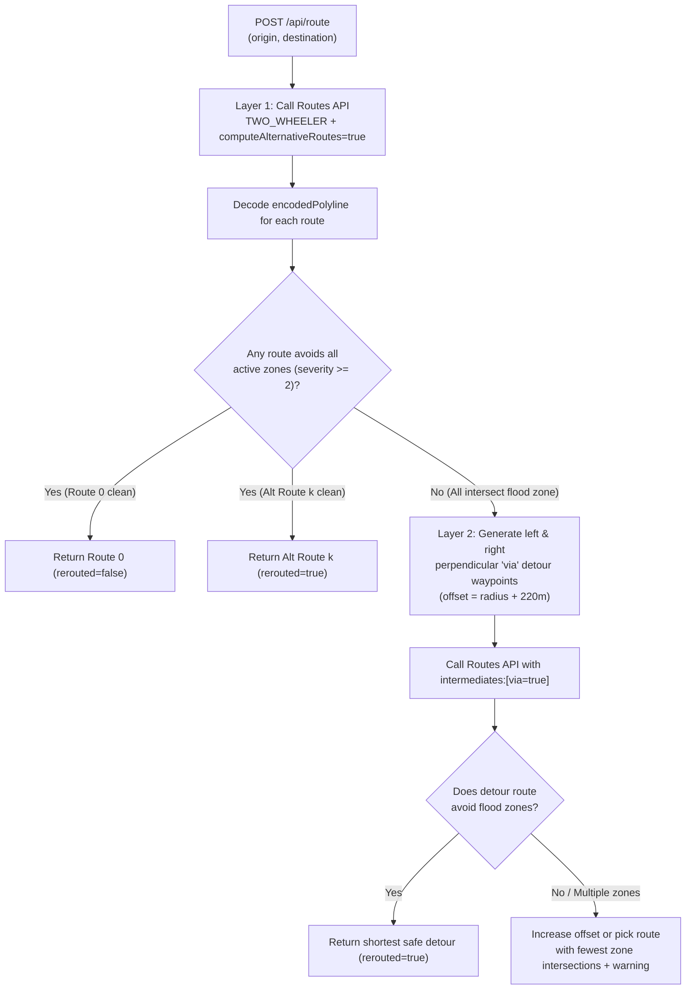

# Deep Reference: Google Routes API v2 & Two-Layer Dynamic Rerouting

This document specifies the exact HTTP contract, verified API constraints, and geometric flood-avoidance algorithm for **Google Maps Platform Routes API v2** (`computeRoutes`).

---

## 1. Verified Routes API v2 HTTP Contract

Endpoint:
```http
POST https://routes.googleapis.com/directions/v2:computeRoutes
```

Required HTTP Headers:
```http
Content-Type: application/json
X-Goog-Api-Key: <GOOGLE_MAPS_API_KEY>
X-Goog-FieldMask: routes.duration,routes.distanceMeters,routes.polyline.encodedPolyline,routes.description
```

> **CRITICAL:** Omitting `X-Goog-FieldMask` causes HTTP `400 INVALID_ARGUMENT`. Avoid `X-Goog-FieldMask: *` in production/demo code as it increases latency and billing tier.

### Validated Payload Variants

#### Layer 1 Request (Primary + Alternative Routes, NO Intermediates)
```json
{
  "origin": {
    "location": { "latLng": { "latitude": 10.7769, "longitude": 106.7009 } }
  },
  "destination": {
    "location": { "latLng": { "latitude": 10.7992, "longitude": 106.7185 } }
  },
  "travelMode": "TWO_WHEELER",
  "routingPreference": "TRAFFIC_AWARE",
  "computeAlternativeRoutes": true,
  "polylineQuality": "HIGH_QUALITY",
  "polylineEncoding": "ENCODED_POLYLINE"
}
```

#### Layer 2 Request (Detour `via` Waypoint, NO Alternatives)
```json
{
  "origin": {
    "location": { "latLng": { "latitude": 10.7769, "longitude": 106.7009 } }
  },
  "destination": {
    "location": { "latLng": { "latitude": 10.7992, "longitude": 106.7185 } }
  },
  "intermediates": [
    {
      "location": { "latLng": { "latitude": 10.7885, "longitude": 106.7020 } },
      "via": true
    }
  ],
  "travelMode": "TWO_WHEELER",
  "routingPreference": "TRAFFIC_AWARE"
}
```

### Hard API Constraints (Verified Against Official Spec)
1. **No Alternatives With Intermediates:** Routes API v2 returns **zero alternative routes** whenever `intermediates` is non-empty (`computeAlternativeRoutes: true` is ignored).
2. **`via: true` Cannot Combine With `optimizeWaypointOrder: true`:** Setting both causes the API request to fail.
3. **Exact JSON Nesting:** An intermediate waypoint uses `{"location": {"latLng": {"latitude": ..., "longitude": ...}}, "via": true}` (do **NOT** double-nest `location.location`).
4. **Duration Format:** `routes[i].duration` returns a Protobuf duration string such as `"780s"` — parse with `int(duration_str.rstrip("s"))`.
5. **Polyline Precision:** Default `ENCODED_POLYLINE` uses Google precision `5` (`polyline.decode(encoded, 5)` returns `[(lat, lng), ...]`).

---

## 2. Two-Layer Flood-Avoidance Algorithm

Because Routes API v2 does not support an arbitrary `avoid_polygons` parameter, `backend/app/services/routing_service.py` enforces safety in two deterministic stages:



### Geometric Math Specification
1. **Point-to-Segment Distance (`point_to_segment_distance_meters`):**
   - For small city-scale segments (`< 10 km`), project flood zone center $P$ onto polyline segment $\overline{AB}$ clamped to $t \in [0, 1]$, then measure exact spherical distance via Haversine ($R_\oplus = 6{,}371{,}000\text{ m}$).
   - A route intersects a flood zone $Z$ if $\min_{i} d(Z.\text{center}, \overline{P_i P_{i+1}}) \le Z.\text{radius\_meters}$ for any active zone with `severity_level >= 2`.
2. **Candidate Perpendicular Detour Generation (Both Sides):**
   - Given travel vector $\vec{v} = (d_\text{lng}, d_\text{lat})$ from `origin` to `destination` and unit normal $\vec{n} = (-d_\text{lat}/\|\vec{v}\|, d_\text{lng}/\|\vec{v}\|)$:
   - Generate **both** `+offset` and `-offset` waypoints (scaled properly for latitude cosine: $\Delta\text{lat} = \frac{\text{offset\_m}}{111{,}111}$, $\Delta\text{lng} = \frac{\text{offset\_m}}{111{,}111 \cdot \cos(\text{lat})}$).
   - Testing both left and right perpendicular offsets ensures we do not push the route into a river/canal (e.g., Saigon River along Nguyen Huu Canh) when only one side has parallel bypass roads!

---

## 3. Reproducible Verification

```bash
# Run deterministic unit tests for Haversine, segment intersection, and detour generation
python -m unittest tests/test_routing_geometry.py -v

# Run standalone CLI reproduction against data/flood_events.sample.geojson
python scripts/repro_routing.py
```
