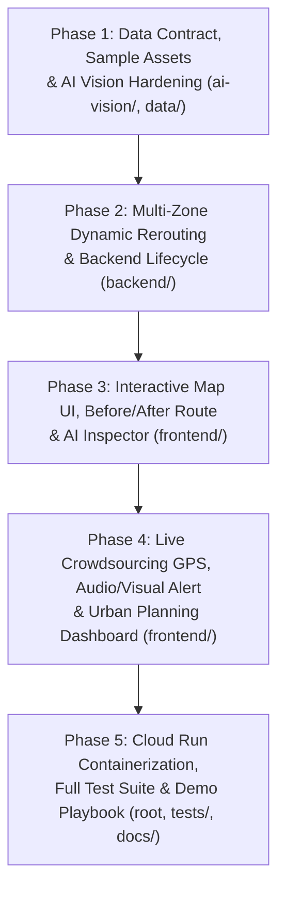

# Kế Hoạch Kiện Toàn Ý Tưởng & Chia 5 Phase Thực Thi Code (`Flood-Safe Routing`)

> [!IMPORTANT]
> Tài liệu này thiết kế lộ trình nâng cấp dự án từ mức khung cơ sở hiện tại (**~28.75%**) lên sản phẩm hoàn chỉnh (**100%**), bám sát **6 tiêu chí chấm điểm của Hội đồng Mentor** và tuân thủ nghiêm ngặt mọi ràng buộc kỹ thuật trong [AGENTS.md](file:///e:/Bách/GDG%202026/AGENTS.md) cùng [docs/api-and-data-contract.md](file:///e:/Bách/GDG%202026/docs/api-and-data-contract.md).

---

## Phần 1: Kiện Toàn Ý Tưởng Theo 6 Tiêu Chí Chấm Điểm Của Hội Đồng Mentor

Để thuyết phục tuyệt đối Ban Giám Khảo & Hội đồng Mentor, sản phẩm không chỉ dừng ở việc "gọi API rồi vẽ đường" mà được kiện toàn thành một **Hệ sinh thái Giao thông Thích ứng Ngập lụt Đô thị (Hyper-local Flood Intelligence)** giải quyết trọn vẹn 6 tiêu chí:

| # | Tiêu chí của Mentor | Điểm nghẽn hiện tại của repo (~28.75%) | Giải pháp "Kiện toàn ý tưởng" sẽ được code trong 5 Phase |
| :-: | :--- | :--- | :--- |
| **1** | **Phù hợp với chủ đề cuộc thi** | Đã định hình bài toán dẫn đường xe máy (`TWO_WHEELER`), nhưng dữ liệu mẫu còn mỏng (`2` camera, `1` điểm ngập). | - Mở rộng kịch bản thực tế tại các "rốn ngập" TP.HCM (Nguyễn Hữu Cảnh, Quốc Hương – Thảo Điền, Ung Văn Khiêm, Võ Văn Ngân). - Phục vụ kép: **Người dân/Tài xế xe máy (B2C/B2B2C)** né ngập tức thời & **Cơ quan quản lý đô thị (B2G)** quy hoạch thoát nước qua Heatmap 30 ngày. |
| **2** | **Có tính khả thi** | Chưa có cơ chế chống spam báo cáo giả, chưa kích hoạt bộ lọc tiết kiệm chi phí Gemini API khi quét camera liên tục. | - **Zero-CapEx:** Tận dụng camera giao thông công cộng sẵn có + Crowdsourcing. - **Frame-Delta Caching (`compute_frame_delta`):** Bỏ qua các frame camera tĩnh không đổi (`delta < 0.04`), giúp giảm **~80% chi phí gọi Gemini API**. - **AI Trust & Anti-Spam:** Gemini kiểm tra ảnh thật/giả, chống nhầm lẫn mặt đường ướt phản chiếu đèn pha với nước ngập, kết hợp cơ chế tự động hết hạn `TTL` khi nước rút. |
| **3** | **Ứng dụng công nghệ Google vào triển khai** | Đã có khung SDK nhưng chưa khai thác sâu đối chiếu lộ trình và chưa có cấu hình đóng gói Cloud Run. | Kết hợp sâu **4 trụ cột Google**: 1. **Gemini 3.8 Flash Vision** (`google-genai`, Structured Outputs `FloodAnalysisLLMOutput`). 2. **Google Maps Platform** (`Maps JS API v3.65+`, `OverlayView` Canvas Heatmap, `Routes API v2` chế độ `TWO_WHEELER` + thuật toán né ngập 2 lớp bằng `via` waypoint). 3. **Firebase** (`Cloud Firestore` `onSnapshot` đồng bộ $<2\text{s}$). 4. **Google Cloud Run** (`Dockerfile` + kịch bản deploy chuẩn serverless). |
| **4** | **Hoàn thiện tính năng để trình bày, demo** | Giao diện đang gắn cứng điểm đi/đến (`DEMO_ORIGIN`, `DEMO_DESTINATION`), chưa có nút lấy GPS, chưa có preset kịch bản demo 1-click. | - Cho phép **click trực tiếp lên bản đồ** hoặc chọn **Preset Kịch bản Demo** (Đường thông thoáng $\to$ Mưa ngập đột ngột $\to$ Tự động bẻ hướng $\to$ Nước rút). - Modal Crowdsourcing có nút **Lấy GPS thực tế**, xem trước ảnh upload và **Bộ ảnh mẫu hiện trường 1-click** để demo sân khấu mượt mà. |
| **5** | **Làm việc nghiêm túc, đúng kế hoạch** | Cần chia nhỏ lộ trình code thành các mốc kiểm chứng độc lập. | - Chia thành **5 Phase rõ ràng** dưới đây; mỗi Phase đều gắn với danh sách file cụ thể, giữ nguyên nguyên tắc `Contract-First` và kiểm tra tự động bằng `check_env.py`, `unittest`, `tsc -b && vite build`. |
| **6** | **Trình bày rõ ràng, trực quan** | Khi bẻ hướng mới chỉ vẽ 1 đường duy nhất, thiếu sự tương phản "Trước vs Sau"; click vào camera/điểm ngập chưa hiện popup phân tích AI; khi thiếu Maps API key chỉ hiện chữ tĩnh. | - **Visual Before/After Rerouting:** Vẽ đồng thời **Tuyến gốc cắt qua vùng ngập (Đỏ nét đứt)** và **Tuyến vòng an toàn (Xanh lá liền nét)** kèm mốc `via` detour. - **AI Vision Inspector Card / InfoWindow:** Bấm vào bất kỳ Camera hay Vùng ngập nào sẽ mở thẻ chi tiết hiển thị ảnh hiện trường, thước đo mức ngập `0–3`, độ sâu `cm`, `visual_cue` và `% confidence` của Gemini. - **Interactive Fallback Map:** Ngay cả khi chạy chế độ chưa có Google Maps key, hiển thị bản đồ tương tác SVG/Canvas trực quan thay vì khung chữ đơn điệu. |

---

## Phần 2: Sơ Đồ Kiến Trúc 5 Phase Thực Thi Code Cho Agent

---

## Phần 3: Chi Tiết 5 Phase Để Agent Thực Hiện Code

### Phase 1: Kiện Toàn Hợp Đồng Dữ Liệu, Bộ Dữ Liệu Thực Địa & Nâng Cấp AI Vision
**Mục tiêu:** Đảm bảo tầng dữ liệu và trí tuệ nhân tạo (`Gemini 3.8 Flash`) có khả năng phân tích chính xác 4 mức ngập, chống ảo giác đường ướt, tối ưu hóa chi phí gọi API bằng `frame_delta` và có sẵn bộ dữ liệu/ảnh mẫu thực tế phong phú.

- **Các file tác động:**
  - [docs/api-and-data-contract.md](file:///e:/Bách/GDG%202026/docs/api-and-data-contract.md)
  - [ai-vision/src/analyzer.py](file:///e:/Bách/GDG%202026/ai-vision/src/analyzer.py)
  - [ai-vision/src/camera_extractor.py](file:///e:/Bách/GDG%202026/ai-vision/src/camera_extractor.py)
  - [data/cameras.sample.json](file:///e:/Bách/GDG%202026/data/cameras.sample.json), [data/flood_events.sample.geojson](file:///e:/Bách/GDG%202026/data/flood_events.sample.geojson), [data/heatmap_history.sample.json](file:///e:/Bách/GDG%202026/data/heatmap_history.sample.json)
- **Công việc cụ thể cho Agent:**
  1. **Cập nhật hợp đồng dữ liệu (`Contract-First`):** Bổ sung các trường tùy chọn (optional, giữ tương thích ngược 100% với bộ test hiện tại) vào `docs/api-and-data-contract.md`:
     - `baseline_route_coordinates` (danh sách tọa độ tuyến đường gốc trước khi né ngập trong `POST /api/route`) để vẽ đường đỏ nét đứt đối chiếu trên bản đồ.
     - `frame_delta_skipped` (boolean trong `CameraPollResultItem`) để hiển thị minh chứng tiết kiệm quota AI khi frame không đổi.
  2. **Tích hợp bộ lọc Frame-Delta & Đường dẫn ảnh cục bộ (`camera_extractor.py`):**
     - Lưu cache in-memory frame gần nhất của từng `camera_id` để tính `compute_frame_delta(prev, curr)`. Nếu `delta < 0.04` (khung hình tĩnh), trả về kết quả phân tích liền trước thay vì tốn lượt gọi Gemini mới.
     - Hỗ trợ chuẩn hóa `local_image_path` tương đối tính từ `ROOT_DIR` để phục vụ kịch bản demo.
  3. **Tinh chỉnh Prompt & Logic phân tích (`analyzer.py`):**
     - Bổ sung quy tắc nhận diện vạch kẻ đường, mép vỉa hè (12–15 cm), bánh xe máy (25–30 cm), ống xả (35 cm) và kiểm tra tính hợp lệ của ảnh hiện trường.
  4. **Làm giàu dữ liệu mẫu (`data/`):**
     - Mở rộng danh sách lên **5–6 camera giao thông trọng điểm** và **6–8 điểm lịch sử Heatmap** tại TP.HCM (Nguyễn Hữu Cảnh, Quốc Hương, Ung Văn Khiêm, Đỗ Xuân Hợp, Võ Văn Ngân...) kèm ảnh mẫu hợp lệ để test các mức `severity_level` từ `0` đến `3`.
- **Tiêu chí nghiệm thu (DoD Phase 1):**
  - Chạy `python scripts/check_env.py` và `python scripts/repro_gemini_vision.py` báo `PASS`.

---

### Phase 2: Nâng Cấp Backend Routing Đa Điểm Ngập & Quản Trị Vòng Đời Sự Kiện
**Mục tiêu:** Hoàn thiện thuật toán **Two-Layer Flood Avoidance** trên Google `Routes API v2` để xử lý nhiều vùng ngập cùng lúc, trả về cả lộ trình gốc lẫn lộ trình vòng tránh, và quản lý trạng thái vùng ngập linh hoạt cho buổi Demo.

- **Các file tác động:**
  - [backend/app/schemas.py](file:///e:/Bách/GDG%202026/backend/app/schemas.py)
  - [backend/app/services/routing_service.py](file:///e:/Bách/GDG%202026/backend/app/services/routing_service.py)
  - [backend/app/services/firebase_service.py](file:///e:/Bách/GDG%202026/backend/app/services/firebase_service.py)
  - [backend/app/main.py](file:///e:/Bách/GDG%202026/backend/app/main.py)
- **Công việc cụ thể cho Agent:**
  1. **Nâng cấp thuật toán Dynamic Rerouting 2 lớp (`routing_service.py`):**
     - Lưu giữ `baseline_route_coordinates` (tuyến đường ngắn nhất mặc định đi xuyên qua vùng ngập) bên cạnh `route_coordinates` (tuyến đường an toàn sau khi né ngập).
     - Nâng cấp Lớp 2: Nếu lộ trình cắt qua nhiều vùng ngập (`len(primary_hits) > 1`) hoặc điểm `via` đầu tiên vẫn chạm vùng ngập lân cận, thử nghiệm tổ hợp các ứng viên `via` vuông góc (trái/phải với bán kính dịch chuyển linh hoạt) để tìm lộ trình an toàn tối ưu nhất, tuân thủ tuyệt đối 5 ràng buộc cứng của `Routes API v2` trong `AGENTS.md`.
  2. **Cộng dồn lịch sử ngập & Điều khiển kịch bản Demo (`firebase_service.py`, `main.py`):**
     - Khi `upsert_flood_zone` ghi nhận vùng ngập `severity_level >= 2`, tự động cập nhật tăng `flood_frequency_30d` và tính lại `avg_severity`, `weight` cho collection `flood_events_history`.
     - Bổ sung khả năng xóa/reset nhanh các điểm ngập phát sinh hoặc kích hoạt kịch bản ngập mẫu (`DELETE /api/flood-zones/{event_id}` hoặc `POST /api/flood-zones/reset`) để nhóm thuyết trình có thể lặp lại kịch bản Demo trên sân khấu chỉ bằng 1 nút bấm mà không cần khởi động lại Backend.
- **Tiêu chí nghiệm thu (DoD Phase 2):**
  - Chạy `python scripts/repro_routing.py` và `python -m unittest discover -s tests -v` đạt **100% PASS**.

---

### Phase 3: Đại Tu Giao Diện Bản Đồ Trực Quan, Chọn Điểm Đi/Đến & Thẻ Phân Tích AI
**Mục tiêu:** Giải quyết triệt để tiêu chí **"Trình bày rõ ràng, trực quan"** của Hội đồng Mentor thông qua việc hiển thị trực quan sự khác biệt trước/sau khi bẻ hướng và minh bạch hóa kết quả suy luận của Gemini 3.8 Flash.

- **Các file tác động:**
  - [frontend/src/types/flood.ts](file:///e:/Bách/GDG%202026/frontend/src/types/flood.ts)
  - [frontend/src/services/api.ts](file:///e:/Bách/GDG%202026/frontend/src/services/api.ts)
  - [frontend/src/components/FloodMap.tsx](file:///e:/Bách/GDG%202026/frontend/src/components/FloodMap.tsx)
  - [frontend/src/App.tsx](file:///e:/Bách/GDG%202026/frontend/src/App.tsx)
- **Công việc cụ thể cho Agent:**
  1. **Đồng bộ TypeScript Interfaces (`flood.ts`):** Khớp 1:1 với `backend/app/schemas.py`.
  2. **Bộ chọn lộ trình thông minh & Kịch bản 1-Click (`App.tsx`):**
     - Thay thế tọa độ gắn cứng bằng thanh chọn **Điểm Đi (Origin)** và **Điểm Đến (Destination)** có sẵn các **Preset lộ trình thực tế** (VD: *Quận 1 $\to$ Thảo Điền qua Nguyễn Hữu Cảnh*, *Hàng Xanh $\to$ Cầu Sài Gòn*, *Tùy chỉnh bằng cách click trực tiếp trên Bản đồ*).
     - Nút **"Khôi phục trạng thái ban đầu (Reset Demo)"** để phục vụ trình diễn liên tục trước nhiều lượt giám khảo.
  3. **Hiển thị song song 2 đường Polyline & Waypoint (`FloodMap.tsx`):**
     - Khi `routeResult.rerouted === true`:
       - Vẽ **Tuyến đường gốc bị ngập** bằng nét đứt màu đỏ (`#ef4444`) đi xuyên qua vòng tròn ngập.
       - Vẽ **Tuyến đường vòng an toàn** bằng nét liền màu xanh lá (`#22c55e`) đi qua `detour_waypoint_used` (có Marker chỉ dẫn điểm bẻ hướng).
     - Khi `routeResult.rerouted === false`: Vẽ tuyến đường tiêu chuẩn màu xanh dương (`#3b82f6`).
  4. **Thẻ AI Inspector / InfoWindow trên Bản đồ (`FloodMap.tsx`):**
     - Khi người dùng click vào Marker Camera hoặc Vùng ngập (hoặc chọn từ danh sách bên trái), hiển thị **Thẻ chi tiết AI Vision**: tên vị trí, nguồn phát hiện (`Camera AI` hay `Crowdsourcing`), thanh mức độ ngập (`0: SAFE` $\to$ `3: SEVERE`), độ sâu ước tính (`cm`), nhận định thị giác `visual_cue`, độ tin cậy `confidence` (%) và trạng thái `Xe máy qua được / Không qua được`.
  5. **Bản đồ tương tác dự phòng (Interactive Vector Preview khi chưa có Google Maps Key):**
     - Nâng cấp màn hình fallback trong `FloodMap.tsx` thành một **bản đồ tọa độ Canvas/SVG tương tác** hiển thị rõ lưới đường, vòng tròn đỏ vùng ngập, vị trí camera, điểm đi/đến, đường đỏ nét đứt vs đường vòng xanh lá và lớp nhiệt Heatmap — giúp giao diện luôn đẹp mắt và demo được 100% tính năng kể cả khi chạy offline!
- **Tiêu chí nghiệm thu (DoD Phase 3):**
  - Chạy `cd frontend && npm install && npm run build` thành công với **0 lỗi TypeScript / Vite**.

---

### Phase 4: Hoàn Thiện Crowdsourcing Có GPS, Cảnh Báo Tức Thời & Dashboard Quy Hoạch Đô Thị
**Mục tiêu:** Hoàn thiện trải nghiệm thời gian thực (Real-time UX) cho cả 2 nhóm người dùng mục tiêu: **Tài xế xe máy ngoài đường** và **Cơ quan quản lý thoát nước đô thị**.

- **Các file tác động:**
  - [frontend/src/components/ReportModal.tsx](file:///e:/Bách/GDG%202026/frontend/src/components/ReportModal.tsx)
  - [frontend/src/components/HeatmapOverlay.tsx](file:///e:/Bách/GDG%202026/frontend/src/components/HeatmapOverlay.tsx)
  - [frontend/src/hooks/useAutoReroute.ts](file:///e:/Bách/GDG%202026/frontend/src/hooks/useAutoReroute.ts)
  - [frontend/src/App.tsx](file:///e:/Bách/GDG%202026/frontend/src/App.tsx)
- **Công việc cụ thể cho Agent:**
  1. **Nâng cấp Modal Báo Ngập Cộng Đồng (`ReportModal.tsx`):**
     - Bổ sung nút **"📍 Lấy vị trí GPS của tôi"** (`navigator.geolocation.getCurrentPosition`) và chọn nhanh vị trí các điểm nóng ngập lụt.
     - Hiển thị khung **Xem trước ảnh (Image Preview)** ngay khi chọn file, kèm thanh chọn nhanh mức mô phỏng (`0: Đường khô`, `1: Ngập nhẹ`, `2: Ngập nửa bánh xe`, `3: Ngập lút bánh`) khi chạy chế độ Demo/Mock.
     - Hiển thị thẻ kết quả phân tích chi tiết của **Gemini 3.8 Flash** ngay sau khi gửi.
  2. **Hệ thống Cảnh báo Tự động Bẻ hướng (`useAutoReroute.ts`, `App.tsx`):**
     - Khi phát hiện điểm ngập đỏ mới xuất hiện cắt ngang lộ trình hiện tại, hiển thị **Banner Cảnh Báo Khẩn Cấp** nổi bật kèm hiệu ứng âm báo ngắn (sử dụng Web Audio API thuần trình duyệt, có nút bật/tắt âm thanh) và bảng so sánh độ chênh lệch quãng đường / thời gian dự kiến cứu xe khỏi chết máy.
  3. **Bảng Thống Kê Quy Hoạch Đô Thị B2G (`App.tsx`, `HeatmapOverlay.tsx`):**
     - Khi bật chế độ **Bản đồ nhiệt (Heatmap)**, hiển thị thêm **Thẻ Phân Tích Đô Thị (Urban Analytics Summary)**: Top điểm đen ngập nặng nhất trong 30 ngày, tổng tần suất ngập, nguyên nhân chính (`Mưa lớn + Triều cường`), và khuyến nghị điều phối thoát nước.
- **Tiêu chí nghiệm thu (DoD Phase 4):**
  - Luồng End-to-End từ lúc bấm "+ Báo ngập" $\to$ Gemini trả kết quả $\to$ Vòng tròn đỏ xuất hiện $\to$ Lộ trình tự động chuyển từ đường đỏ nét đứt sang đường vòng xanh lá diễn ra mượt mà trong $<2$ giây.

---

### Phase 5: Đóng Gói Google Cloud Run, Kiểm Thử Toàn Diện & Kịch Bản Demo Sân Khấu
**Mục tiêu:** Sẵn sàng 100% cho việc triển khai thực tế lên hạ tầng **Google Cloud Run**, vượt qua mọi bài test tự động và cập nhật hồ sơ nghiệm thu cho Hội đồng Mentor.

- **Các file tác động:**
  - `Dockerfile`, `.dockerignore` (tạo mới tại thư mục gốc)
  - [tests/test_contracts_and_routing.py](file:///e:/Bách/GDG%202026/tests/test_contracts_and_routing.py)
  - [docs/progress-log.md](file:///e:/Bách/GDG%202026/docs/progress-log.md)
  - [docs/verification-and-demo-playbook.md](file:///e:/Bách/GDG%202026/docs/verification-and-demo-playbook.md)
- **Công việc cụ thể cho Agent:**
  1. **Đóng gói Cloud Run (`Dockerfile`, `.dockerignore`):**
     - Thiết kế `Dockerfile` tối ưu (cài đặt `backend/requirements.txt` + `ai-vision/requirements.txt`, copy `backend/`, `ai-vision/`, `data/` và khởi chạy `uvicorn app.main:app --host 0.0.0.0 --port ${PORT:-8080}`) để deploy trực tiếp lên **Google Cloud Run** chỉ với 1 câu lệnh `gcloud run deploy`.
  2. **Mở rộng Unit & Contract Tests (`tests/test_contracts_and_routing.py`):**
     - Bổ sung test cho: `baseline_route_coordinates`, né đa điểm ngập liên tiếp (multi-zone detour), bộ lọc `frame_delta` chống gọi lặp Gemini API, cộng dồn `flood_events_history`, và endpoint reset kịch bản demo.
  3. **Chạy toàn bộ 5 lệnh Verification chuẩn (`AGENTS.md`) + Build Frontend:**
     - `python scripts/check_env.py`
     - `python -m unittest discover -s tests -v`
     - `python scripts/repro_routing.py`
     - `python scripts/repro_gemini_vision.py`
     - `python scripts/repro_camera_fetch.py`
     - `cd frontend && npm run build`
  4. **Cập nhật Nhật ký tiến độ & Playbook thuyết trình (`docs/`):**
     - Cập nhật `docs/progress-log.md` và `docs/verification-and-demo-playbook.md` phản ánh đầy đủ các tính năng đã hoàn thiện để trình bày trước Mentor.
- **Tiêu chí nghiệm thu (DoD Phase 5):**
  - Toàn bộ unit tests, repro scripts và bản build Production Frontend (`dist/`) đều thành công 100%, không còn bất kỳ cảnh báo hay lỗi tiềm ẩn nào.
